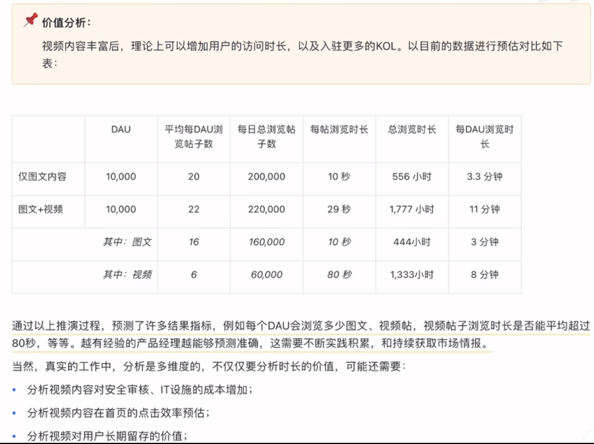
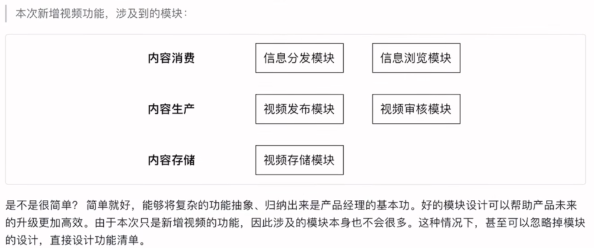
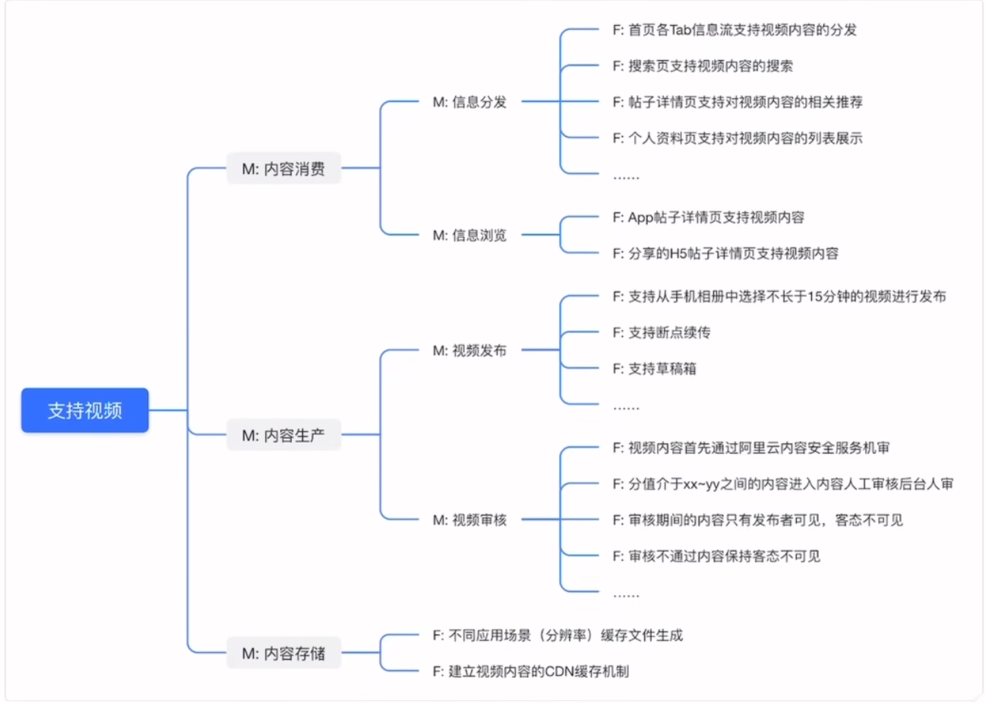
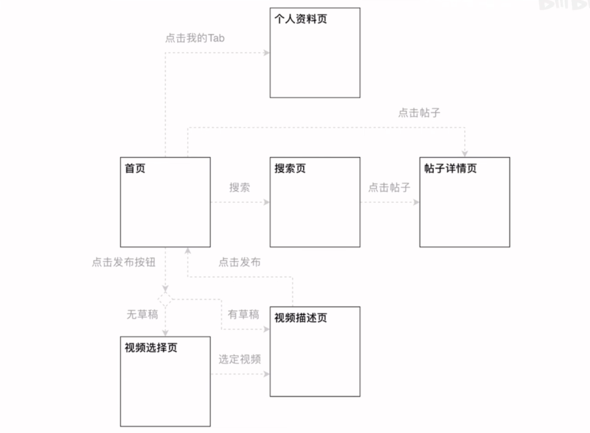
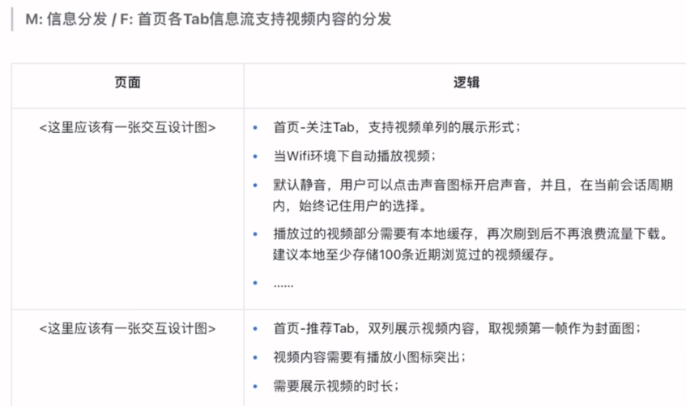
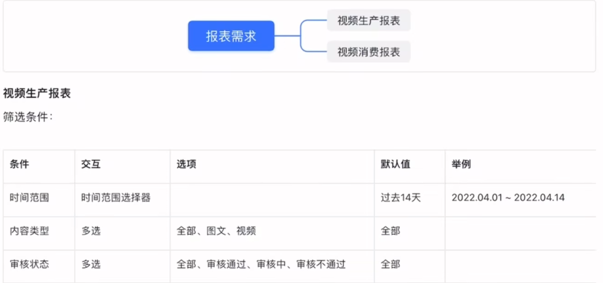
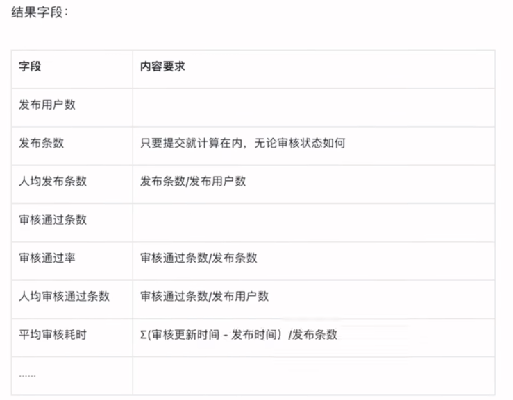

# 1.版本说明
- 需要包含四项内容：版本号、更新时间、更新人、更新内容
# 2.背景与目标
## 2.1.背景
- 层次1.对当前产品大的背景介绍（如：为什么公司需要你现在在设计的这样一个产品/功能，它在业务上到底能带来什么，这一层往往可以链接到产品的宏观设计文档）
- 层次2.对当前整个故事所处的背景进行更加微观的介绍（例：某社区app已经上线x月，DAU稳定到xx，每日有xx多原创内容发布，累积了一定的种子用户，也保持了一定的图文内容发布的活跃度，为了进一步扩展内容的种类，提升用户的访问时长，希望尽快支持用户能够发布短视频内容；
同时，目前许多主流用户本身就是其他平台的短视频博主，内容生产均是基于视频的形式，只有图文发布功能会加大运营难度，损失头部KOL）
## 2.2.目标
- 目标指大概要上线什么功能，以什么指标衡量（例：通过上线短视频发布、浏览、分发功能、扩充内容丰富度、数量与用户的浏览时长等，希望本次迭代上线1个月后能够实现：
1.每日至少有100位用户发布短视频内容；
2.短视频内容浏览量占比大盘帖子浏览量的25%+；
3.短视频3日平均每条访问量不低于300次，互动率不低于10%（评论+点赞）；
4.app人均日访问时长从3分钟提升至10分钟）
# 3.故事介绍
## 3.1.用户场景
- 如果在背景与目标里还未能将用户的使用场景描述透彻，则可以继续深入向读者介绍一下未来用户的使用场景，加深画面感（例：用户场景：
1.用户可以发布15分钟以内的视频，暂不支持app内拍摄视频；
2.视频发布流程支持断点续传；
3.用户可以在信息流中显著地区别出视频内容，也可以只浏览视频内容；
4.用户可以将视频转发到社交网络，如微信、QQ、微博、即刻；
5.用户可以对视频进行像图文帖子一样的点赞、评论操作；
6.用户发布的视频会经过严格的内容安全审核步骤……）
- 用户场景没必要写得太复杂，能有简单的画面感即可，甚至可以截图一些竞品的界面加深这个画面感
## 3.2.价值分析
- 介绍完画面感后辅以一些数据推演增加对目标的可及性介绍，增强团队信心。

## 3.3.核心体验路径
- 产品设计的五张图-图1
- 以发布者为例：选择内容类型（图文/视频）→选择视频→描述视频→提交并等待审核→过审发布成功
## 3.4.产品指标预测
- 当体验路径明确之后，核心的过程指标便可以继续完善。除了在目标环节明确的业务指标外，产品经理还应该关注产品体验本身的漏斗指标，例如：
1.表明发布意向→提交并等待审核的比例%，首月预测为80%±。
预计会有一部分用户抱着试一试的态度选择发布视频，但发现我们目标没有美化、剪辑视频的功能，因此会放弃当次发布，在其他app中处理后再发起发布流程；
2.提交成功→过审发布成功的比例%，首月预测为70%±。
预计会有一部分用户发布带有水印、违反社区规则的内容，也有可能会有一些用户恶意刷屏，需要一段时间的引导，随着用户逐渐熟悉新功能，应该会逐步提升。
## 3.5.路径规划
- 每一个sprint往往只能完成一部分功能，为了能够让研发团队更好地架构技术框架，建议对未来可能发生的产品变动做出预告。（例：1.当前版本：实现视频的上传和浏览互动；2.未来可能的功能升级：2.1 实现更长时间视频的承载，例如1小时；2.2 实现用户可以自定义封面；2.3 实现更聪明的视频审核机制，以节省审核成本；2.4 可能会考虑支持简单的视频裁切、贴纸、滤镜、文字等编辑功能，提升视频的可观赏性；2.5 可能会考虑支持视频直接拍摄、配乐功能。）
- 如果有更加明确的产品路线图更好
# 4.概要设计
- 将画面转化为研发团队能够拆解、开始研发的产品设计语言。模块、功能清单、页面结构三者描述的内容是互相有所重叠的，因此，它们既可以从不同维度表述设计细节，又可以互相验证设计的健壮度，避免遗漏。
## 4.1.模块设计
- 模块设计相对抽象一些，主要起到归纳理解的作用，避免在设计大方向上有所遗漏。比如设计了C端体验却忘了设计后端对应的配置等。

## 4.2.功能清单
- 功能清单是基于模块的进一步细化，把我们在每个模块中会发生的功能全部列举出来，是下一步详细设计的目录
- 也可以跳过模块设计图，直接从功能清单开始，M开头代表模块，F开头代表功能

- 功能清单可以方便研发团队先理解全貌，在后文的详细设计章节找到自己负责的功能浏览即可。
## 4.3.页面结构
- 可见的页面是日常用户最直接使用的接口，通过页面结构的简单表述可以继续加强团队对产品的全貌理解。在一些涉及页面比较多（比如5个以上）的PRD中是必备的。
- 和功能清单相互呼应（如果设计了一个页面，但这个页面在刚刚的功能清单里没有出现过任何功能，那这个页面是否多余了？还是功能清单漏东西了？
- 反之，如果功能清单中有几个功能发现在现有页面中无法承载，那么是否漏页面了？这是一个自洽的过程，因此至少使用两种索引方式（此处为功能清单+页面结构）帮助做产品设计的自洽

- 从这一步开始和交互工程师工作，使用原型工具将页面具象化，可以一开始低保真，也可以一上来就是高保真的ui
# 5.详细设计
- 顺着功能清单有逻辑地将每个功能、页面的设计内容阐述清楚，通过不断的写、读、改，最终输出逻辑严谨的内容。
- 在这一步再次与前面的功能清单和页面结构等进行自洽。

（详细设计的最终产物即产品经理的五张图中的原型设计图，可参考根目录下的“产品经理的五张图”）
# 6.交付设计
## 6.1.数据分析设计
- 指明确当前版本需要新增、更新的数据埋点内容，以及未来可能需要的分析报表。
- 主要面向对象为研发工程师及数据分析师，告知研发工程师需要做哪些埋点，以及告知数据分析师需要看哪些数据。
- 在测试阶段，数据分析师也是一个用户，测试工程师埋点是否正确，是否能生成我们想要的报表，如果不行，那么产品测试依然是不通过
### 6.1.1.埋点设计
- 干了什么（action）、view了什么东西
- 在产品还没有进研发之前就想好要看什么数据，这样才可能不会遗漏埋点
- 价值分析章节的所有数据都应该在数据分析的设计中想明白
### 6.1.2.报表设计
- 罗列好需要看的报表内容和目的即可。
- 规划报表时也需要有产品思维，抽象、归纳、判断分析需求是对现有报表的升级，还是需要新增报表。

## 6.2.上线筹备设计
- 每次上线都要考虑新功能是否会影响其他团队（依赖公司中台的另一个功能上线等）or历史数据，需要明确指名会发生的冲突及解决方案（例：本次上线存在数据冲突，需要重新申请阿里云内容安全的密钥与主题，避免视频内容的审核数据与图文冲突。负责人：xx。
本次上线前需要DevOps提前规划好CDN的部署，并对相关云账号进行预充值；负责人：xx……）
## 7.来自产品上线后的更新
- 在产品上线1、2周后（数据比较稳定），对功能做出复盘，并更新到原先的设计文档下方（当时我们想要的目标价值、漏斗数据真实情况是怎样的），让自己的思考真正闭环
## version design（仅作留白提示，无需关注）